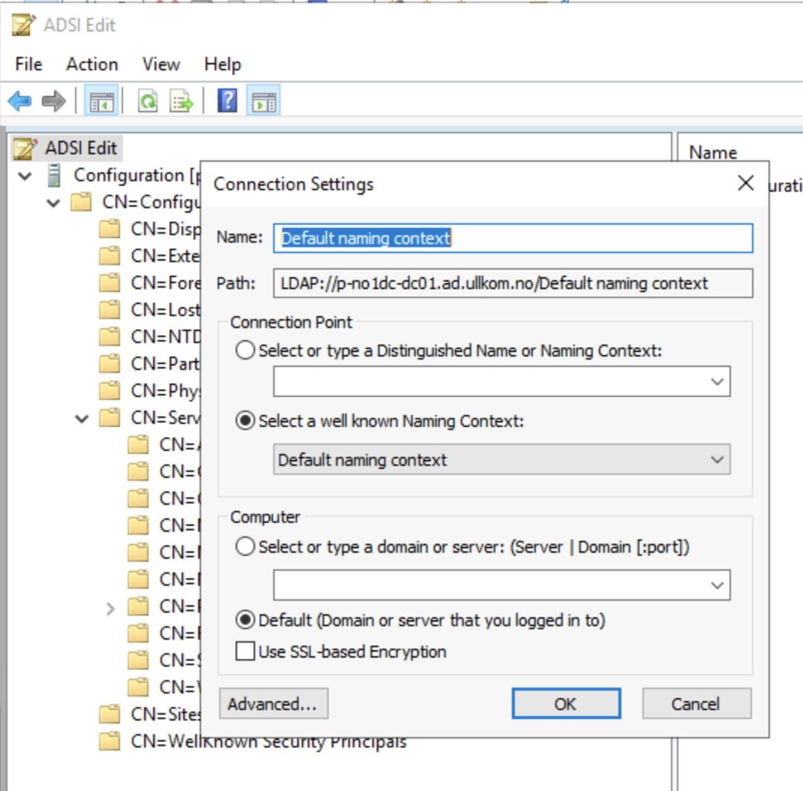
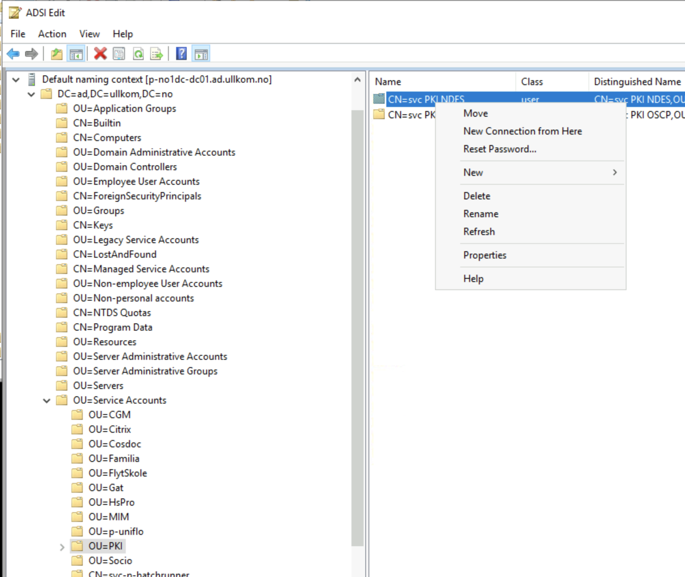
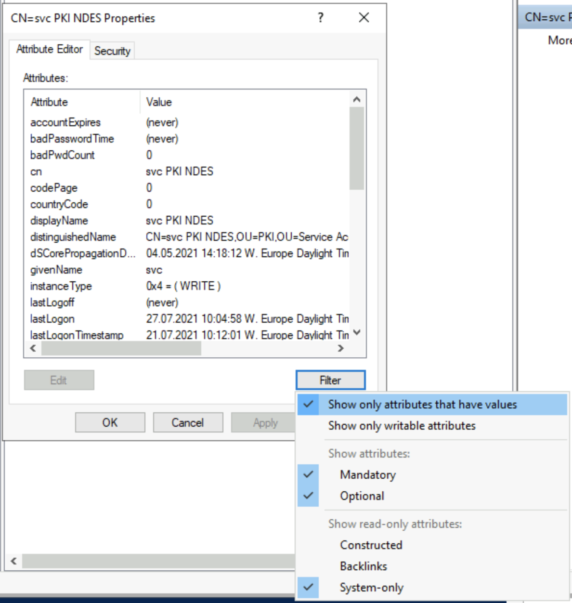

# AD - Administrative Limits


I recently ran into an issue with a particular environment where Active Directory and PKI services were deployed. One of the service accounts which I was attempting to 'unlock' refused to co-operate and instead offered the most unhelpful message.
 
`Administrative limit for this request was exceeded` - this was not my first time encountering the message, previously this haunted me while I was managing a Windows PKI infrastructure and with some quick searches, confirmed my initial suspicion. This is a symptom of an AD object quite simply being to large!

## Explaination

Active Directory is in the simplest form a Database, and each object can be considered as a row in this database. Like any database there are limits to what data can be stored in the table, the type of data, but also the amount. 
## Resolving the problem

Using a tool like **ADSI Edit** will allow you to open the database, and select the schema partition we would like to work with. Standard objects which we can see in the *Active Directory Users and Computers* extension are all hosted in the partition called the *Default Naming Context*; which is where we need to focus for this problem



### Identifying the Bloat

There is no super cool trick here, we just need a little investigation. Start by navigating the OU structure you are familiar with in Active Directory Users and Computers, to locate the account with issues.



Right Click on the object, and select **Properties** where you now get to view the 100's of columns of data which AD stores for each object. 

Click on the **Filter** button and enable the option *Show only attributes that have values* - this will remove all the columns which are empty - and therefore not adding to our overside object!



Now, you can check each of the remaining attributes (columns) and see what they contain, I'll save a few minutes, and in this case I expect my issue is to do with Certificates, so we will focus on the attribute called *userCertificate* which contains an collection of *[byte[]]*, each representing a Base64 encoded Certificate.

BINGO! looking at this property I can see 100's of entries, and each one has the same *byte[]* string, which implies the same certificate is loaded into the object a lot of times.

I am going to flush the lot of them out, as these are added by the system, and it will reload them as required; but for now, I am simply the garbage collector.

Using the UX, we can delete these 1 at a time, so we need a little automation, or the rest of the week will be wasted.

## Powershell Helper

Using standard Active Directory module for Powershell, we can get a reference to the object which needs to be flushed

```powershell
$certUser = Get-Aduser "svc_PKI_NDES" -Properties certificates
```

Now, let's check what we got from AD

```powershell
$certuser.Certificates.Count
1169
```

Right, time to fix this, we will use the following command to remove all the certificates from the object

```powershell
PS C:\Users\sysadmin.AD> set-ADUser svc_PKI_NDES -Certificates @{}
```

And, let's confirm it worked
```powershell
$certuser = Get-ADUser svc_PKI_NDES -Properties Certificates
$certuser.Certificates.count
0
```

And now, just check that you can unlock the account, or complete the operation that sent you chasing this wild goose!

---
<!-- enrich:containment -->
*Part of: damianflynn*

