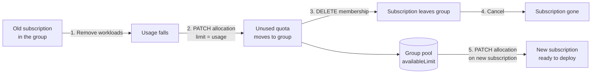
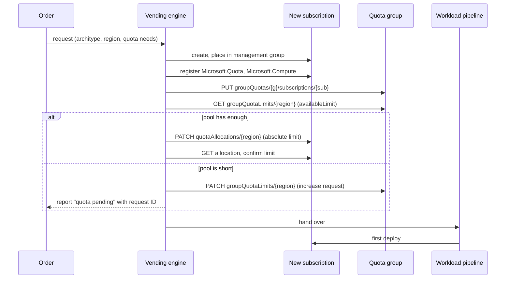

# Azure Quota Groups: Recycling Capacity You Already Own


The most expensive vCPU in Azure is the one you already had approved, gave back by accident, and now have to ask for again. That is exactly what happens every time an old subscription is cancelled. Years of quota increases, each one a support ticket, a business justification and a few days of waiting, disappear with the subscription. Meanwhile the brand-new subscription that replaces it starts life with default limits, in a region where capacity is tight, and the first deployment into it fails with a quota error the platform team then has to chase.

For most of Azure's history there was no way around this. Quota was a property of the subscription: granted to it, enforced on it, and lost with it. Azure Quota Groups change that. They lift compute quota from the subscription to a group object, so quota can be pooled across subscriptions, handed back to the pool when a workload shrinks or is retired, and handed out again to a new subscription without a ticket.

I spend a lot of my time on landing zones and on subscription vending, the automated process that creates a subscription, places it in the management group hierarchy, wires it to the network and hands it to a team with a working deployment pipeline. In our case that engine is called Concierge. When a reviewer asked recently whether we should be putting every new subscription into a quota group as part of vending, especially as older subscriptions are being decommissioned, it was the right question, and working through the answer properly is what this post is about.

Quota Groups fit the problem well. They are also more subtle than the announcement suggests, and three limits decide whether you can use them at all. They only accept Enterprise Agreement and Microsoft Customer Agreement subscriptions, which rules out anything bought through a Cloud Solution Provider. They only cover IaaS compute quota, the vCPU limits per VM family. And they do nothing for region or zone access, which is a separate gate that fails in a confusingly similar way. If you run vending through a CSP partner, the first of those ends the conversation before it starts, and you need a different design.

First, what quota actually is, because everything after depends on it.

## Quota, capacity and access are three different gates

When a deployment fails to get compute in Azure, it is usually one of three things, and they are often confused.

**Quota** is a limit Azure enforces on your subscription: how many vCPUs of a given VM family you may run in a given region, plus a total regional vCPU limit across families. It is a number on your subscription, it is checked at deployment time, and exceeding it fails the deployment with a quota error such as `QuotaExceeded` or an `OperationNotAllowed` that names the family and the limit. Quota is not capacity. A high limit does not mean the hardware is free; it means Azure has agreed you may use up to that much.

**Capacity** is whether the region actually has the hardware to place your VM right now. When it does not, you get an allocation failure such as `AllocationFailed` or `ZonalAllocationFailed`, even with plenty of quota. Quota increase requests are themselves checked against capacity, which is why increases in busy regions can be rejected or take a long time.

**Access** is whether your subscription may use a region, a zone or a VM size at all. Some regions are reserved and need an explicit access request. Within an open region, a specific size can be restricted for a specific subscription, which you can see in the SKU list: `az vm list-skus --location <region> --size <size> --all` returns a `restrictions` block, with a `type` of `Location` or `Zone` and a `reasonCode` of `NotAvailableForSubscription`. A deployment that hits it fails with `SkuNotAvailable`.

Quota Groups address the first gate only. Microsoft says so plainly in the documentation: "Quota Groups addresses the quota management pain point, it does not address the regional and or zonal access pain point." Keep that sentence in mind, because it comes back when we get to automation.

## What a quota group actually is

A quota group is an Azure Resource Manager object of type `Microsoft.Quota/groupQuotas`. It is created at a **management group** scope and inherits its permissions from that management group, but it is not tied to the hierarchy beneath it. Membership is explicit: you add subscriptions to it through the API, from any management group, and nothing is synchronised automatically. A subscription can belong to one quota group at a time.

Creating one is a single `PUT`:

```http
PUT https://management.azure.com/providers/Microsoft.Management/managementGroups/{mgId}/providers/Microsoft.Quota/groupQuotas/{groupName}?api-version=2025-03-01

{
  "properties": {
    "displayName": "platform-compute-pool"
  }
}
```

Adding a subscription is another `PUT`, with no body:

```http
PUT https://management.azure.com/providers/Microsoft.Management/managementGroups/{mgId}/providers/Microsoft.Quota/groupQuotas/{groupName}/subscriptions/{subscriptionId}?api-version=2025-03-01
```

Both return `provisioningState: ACCEPTED` and complete asynchronously, so any automation has to poll before it moves on.

Two prerequisites catch people out. Every member subscription needs the `Microsoft.Quota` and `Microsoft.Compute` resource providers registered before it is added. And the roles are split across two scopes: *GroupQuota Request Operator* on the management group that holds the group, to create it and manage its limit, and *Quota Request Operator* on each participating subscription, to move quota in and out of it.

### The group limit starts at zero

A new quota group has a limit of **zero**, and that surprises most people. Adding subscriptions does not change that. The documentation is explicit: "When added to the group, subscriptions carry their existing quota and usage. The subscriptions' quota isn't manipulated when added to a group. Subscription quota remains separate from the group limit."

So the group limit is its own pot, separate from the members' limits, and you fill it in one of two ways:

1. **Deallocation.** You move unused quota from a member subscription into the group.
2. **A group limit increase.** You ask Microsoft for more quota at the group level, for one region and one VM family at a time. It goes through the same capacity checks as a subscription request, and if it is rejected you fall back to a support ticket raised from the quota group blade. If it is approved, the quota is stamped on the group rather than on any one subscription.

### Deployments still check the subscription

The other thing to internalise is where the check happens. The documentation says: "When deploying resources the quota check at runtime is done against the subscription quota." The group is never consulted when you deploy. Quota in the group is inventory; it does nothing until you **allocate** it to a subscription.

That single fact shapes every automated flow. Putting a new subscription into a group gives it nothing. Somebody, or something, has to move quota from the group to the subscription before the first deployment, or that deployment fails exactly as it would have without a group.

## Allocation and deallocation are absolute, not deltas

Moving quota in either direction uses the same call, and the semantics are easy to get wrong. You `PATCH` the subscription's **allocation** for a region, and you set the **new absolute limit** you want the subscription to have, not the amount to move.

```http
PATCH https://management.azure.com/providers/Microsoft.Management/managementGroups/{mgId}/subscriptions/{subscriptionId}/providers/Microsoft.Quota/groupQuotas/{groupName}/resourceProviders/Microsoft.Compute/quotaAllocations/{location}?api-version=2025-03-01

{
  "properties": {
    "value": [
      {
        "properties": {
          "resourceName": "standardddv4family",
          "limit": 50
        }
      }
    ]
  }
}
```

If the subscription currently has 60 vCPUs of that family, setting 50 **deallocates** 10 to the group. If it has 40, setting 50 **allocates** 10 from the group. The direction is implied by the difference between the current limit and the one you send.

Two constraints follow from that. You cannot deallocate below what the subscription is using, so quota is only reclaimable once the VMs consuming it are gone. And you cannot allocate more than the group has available.

Reading the state back is where the vocabulary matters. The allocation snapshot for a subscription returns its `limit` and a `shareableQuota`; a value of `-10` means that subscription has given 10 vCPUs to the group. The group's own view, from `groupQuotaLimits/{location}`, returns three numbers that are easy to conflate:

- `limit` is what has been **stamped** on the group by approved increase requests.
- `availableLimit` is what the group can **hand out right now**, including quota deallocated from members.
- `allocatedToSubscriptions` lists each member's net movement, negative for subscriptions that have given quota back.

In the documentation's own example, a group with a stamped `limit` of 40 shows an `availableLimit` of 50, because a member had already deallocated 10. If you build reporting or automation on top of this API, `availableLimit` is the number that answers "can I allocate this?".

## Recycling quota from decommissioned environments

Decommissioning is the scenario that prompted the question, and it is where Quota Groups pay for themselves. Most estates that have been in Azure for a while are carrying subscriptions that are being consolidated or retired: old per-environment subscriptions, a previous generation of landing zone, workloads moving to a new hierarchy. Each one holds quota that somebody fought for.

The decommissioning flow with a quota group looks like this:



The order matters, and it is the order most decommissioning runbooks get wrong if they were written before quota groups existed.

1. **Join the old subscription to the group first.** A subscription that is not a member cannot deallocate into it. If your retiring subscriptions predate the group, adding them is step zero.
2. **Remove the workloads.** Deallocation cannot go below usage, so the VMs, scale sets and anything else consuming the family have to be gone first.
3. **Deallocate per region and per family.** Set each allocation to the remaining usage, normally zero. This is one `PATCH` per region, with one entry per family in the body. Check `shareableQuota` afterwards.
4. **Remove the subscription from the group.** On removal, "subscriptions carry their existing quota and usage. The group limit isn't manipulated based on subscription removal." Quota already deallocated stays in the pool.
5. **Only then cancel the subscription.** Cancel first and the quota goes with it, which is exactly what you were trying to avoid.

Done in this order, a retirement programme becomes a quota source rather than a quota sink. Every subscription you close tops up the pool that the next one draws from, and the support tickets you raised years ago keep paying out.

One governance point is easy to miss. Deleting the management group that holds a quota group loses access to its limit, recoverable only by recreating a management group with the same ID. If you are reshaping your hierarchy at the same time as retiring subscriptions, which is common, put the quota group on a management group that is not going anywhere. A dedicated platform management group near the root is a better home than a landing-zone group that might be renamed or collapsed.

## How it would fit an automated vending flow

A subscription-vending engine like Concierge runs a fixed sequence for every order: create the subscription, place it in the right management group, allocate its address space, create its repository and pipeline, give its deployment identity the access it needs, and hand over. The first deployment is the workload's own pipeline, running as its own identity. That is deliberate, because the first run is the proof that the pipeline works. It also means that if the subscription lacks the quota the workload needs, the order is reported as complete and then the very first thing the team does fails.

With a quota group available, the vending flow gains one step between placement and handover:



A few design decisions fall out of building this rather than drawing it.

**The order has to say what quota it needs.** The engine cannot guess. The cleanest place for that is the architype, the template a workload is built from, which already knows its VM families and sizes. The order then carries region, family and vCPU count, with the architype supplying defaults.

**The engine allocates; it does not manage the pool.** Allocating from the group on behalf of a new subscription is a vending concern. Raising the group limit, deciding how much headroom to hold, and deallocating from retiring subscriptions are platform-ownership concerns. Mixing them gives an automated service the power to drain a pool that other teams depend on. In our design, the engine reads `availableLimit`, allocates if it can, and otherwise reports the shortfall rather than escalating on its own.

**"Done, quota pending" is a real state.** Increase requests are asynchronous and can be rejected. The order should be able to complete with an explicit warning and the request ID, so nobody runs the first deployment into a known shortfall and nobody believes a subscription is ready when it is not.

**The roles are a real expansion of trust.** The vending identity needs *Quota Request Operator* on each subscription it creates, which is modest because it usually owns those subscriptions anyway. It also needs *GroupQuota Request Operator* on the management group that holds the group, which is a standing grant at management-group scope in the customer's tenant. That deserves the same scrutiny as any other privileged grant, and it is another argument for a dedicated management group.

**One group per tenant, configured per customer.** The group lives under a management group in one tenant. A vending engine that serves several customers from one deployment needs the group ID as customer configuration, not as a global setting.

Whether you can build any of it depends on three limits.

## The three limits that decide whether you can use it

### Billing: no CSP

The documentation lists it as the first limitation: "Available only for Enterprise Agreement, Microsoft Customer Agreement (MCA), and Internal subscriptions."

Subscriptions bought through a Cloud Solution Provider, the partner-led Azure Plan billed under a Microsoft Partner Agreement, are none of those. They cannot be added to a quota group. That is not a configuration gap you can engineer around; the API will not accept them.

This matters more than it sounds, because a large share of managed estates are CSP. A managed service provider vending subscriptions for customers through its partner tenant is creating exactly the subscriptions Quota Groups exclude. Concierge supports all three agreement types, EA, MCA and MPA, but where a customer is billed through CSP, the vending engine has nothing to join the new subscription to.

The useful nuance is that an estate can be mixed. If the subscriptions being retired are EA or MCA, a quota group can still pool quota *between them* while they are wound down, and allocate it to other EA or MCA subscriptions. What it cannot do is carry that quota across the billing boundary into new CSP subscriptions.

### Scope: IaaS compute only

The second limitation is "Supports IaaS compute resources only." The group APIs live under `resourceProviders/Microsoft.Compute`, and the unit is the VM family vCPU limit. That covers virtual machines and scale sets.

It does not cover the quota that, in my experience, blocks new workloads most often today: Azure OpenAI tokens per minute, App Service and Functions plans, Container Apps environments, database vCores, public IP addresses. Each of those has its own quota and its own request process, usually per subscription. A platform built on PaaS and AI services can adopt quota groups and still find that most of its first-deploy failures are untouched by them.

### Access: not a quota problem

The third limitation causes the most confusion, because it fails in a way that looks like quota. Quota transfers and deployments "will fail unless regional and or zonal access is provided on the subscription." A new subscription can be denied a reserved region, a zone, or a specific VM size, and no amount of quota in a group changes that. You can allocate 200 vCPUs of a family to a subscription and still have every deployment fail with `SkuNotAvailable`.

Access is fixed through the region access request process, which is a support request, not an API call. For reserved regions it is an "Other Requests" ticket listing the subscriptions, region and planned usage. An automated flow can detect the restriction up front by reading the SKU restrictions for the target region and sizes, and it should, because it is far cheaper to report "this subscription cannot use this size here" at vending time than to let the workload team discover it.

## What we do instead when the subscriptions are CSP

Because Concierge vends CSP subscriptions for some customers, we recorded the decision in an architecture decision record rather than leaving it in a review thread. It comes down to the same three gates, handled without a pool.

**Quota is part of the order.** After placement, the engine registers the providers it needs, reads current usage and limits through the `Microsoft.Quota` API at subscription scope, and raises a **per-subscription** increase for any shortfall, for whatever resource type the architype declares, not only compute. The quota API addresses a subscription's limits by scope, along the lines of `/subscriptions/{id}/providers/Microsoft.Compute/locations/{region}/providers/Microsoft.Quota/quotas/{family}`, and the same pattern covers other providers that publish their limits through it. Whether every provider accepts API increase requests on a CSP subscription, or some still need a ticket, is something we are verifying on a test subscription before we rely on it.

**Access is checked, not assumed.** The engine reads SKU restrictions for the target region and sizes and reports any `NotAvailableForSubscription` before handover, with the region access request listed as an action rather than buried in a failed pipeline run.

**The outcome is recorded on the order.** Granted, pending with a request ID, or rejected. The order can finish as "done, quota pending", and the ticket that tracks it says so.

**Quota groups stay as an option for EA and MCA customers.** Where the customer's configuration names a group, the engine joins the subscription and allocates compute from it instead of raising a per-subscription compute request. Everything that is not compute still goes through the per-subscription path.

It is less elegant than a single pool. It still turns a failed first deployment into a known state at vending time, which is the outcome that actually matters to the team receiving the subscription.

## Where this leaves you

Quota Groups solve a real and old problem: quota you paid for in time and tickets no longer has to die with the subscription that held it. For EA and MCA estates, especially ones in the middle of consolidating or retiring subscriptions, the flow is worth building now. Join the retiring subscriptions, deallocate before you cancel, keep the group on a management group that will outlive your current hierarchy, and let vending allocate from the pool rather than raise tickets.

Go in with the boundaries clear, though. The group is inventory, not entitlement: the subscription is what gets checked, so allocation is a step, not a side effect. It covers VM families, not the PaaS and AI quota that increasingly gates new workloads. It does nothing for region or zone access. And if your subscriptions come through CSP, it is not available to you at all, so the design has to treat quota, capacity and access as explicit, per-subscription parts of every order.

That last point is the one I would carry into any vending design, pool or no pool. A subscription is not ready because it exists. It is ready when the first deployment of the workload it was built for can succeed, and quota and access are part of that definition.

