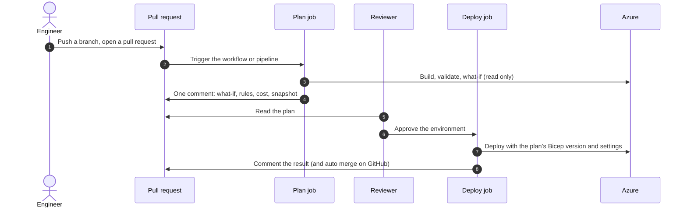

# bicep-action: Plan, Review and Deploy Bicep from Pull Requests


Terraform teams stopped deploying blind years ago. They open a pull request, a bot runs `terraform plan` and posts the result as a comment, a colleague reads exactly what will be created, changed and destroyed, and only then does anyone type `atlantis apply`. Most Bicep teams still merge and find out. The pipeline runs, the deployment succeeds or fails, and the first time anyone sees what Azure actually did is in the activity log afterwards.

That gap is why we built **bicep-action**. It is a pair of GitHub actions and an Azure DevOps pipeline that run Bicep the way Atlantis runs Terraform. Every change is planned in the pull request, the plan is reviewed by people, and only the approved plan is deployed. GitHub and Azure DevOps run the same shell scripts and post the same pull request comments, so a team can move between the two platforms without relearning anything.

It is free. The code and documentation are published under the BSD 3-Clause licence in a public repository, [innofactororg/bicep-action](https://github.com/innofactororg/bicep-action), and you can pin it, fork it or read every line of it. It is also not a weekend project. The first commit was in November 2023, it has shipped fifteen releases since, and it is the mandated pipeline for every Bicep workload repository in one of the larger managed Azure estates we run, on Azure DevOps, as well as the pipeline behind the workloads our subscription-vending engine creates. Every fix in this week's release, `v2026.11.13`, came from something a production pipeline hit.

This post walks through what it does, how it compares with Atlantis, and how to run it for one environment or for several.

## What happens when you open a pull request

The flow has two jobs and a person in between.



The **plan job** only reads from Azure. It compiles the template, validates it, asks Azure what the deployment would change, runs the quality checks, and posts everything as **one comment** on the pull request. Any failed check fails the plan, and the deployment never starts.

The approval step uses what each platform already has. On GitHub it is an environment with required reviewers; on Azure DevOps it is an environment with an approval check. There is no bespoke approval mechanism to learn or secure.

The **deploy job** runs only after a successful plan and an approval. It deploys, comments the result on the same pull request, and on GitHub can turn on auto merge, so the branch is merged the moment the deployment succeeds. Main stays a record of what is actually deployed, which is the same property Atlantis users rely on.

## What the plan checks


A plan is more than a what-if. The plan job runs a sequence of gates, each of which can fail the plan:

| Step | What it checks | Fails the plan when |
|---|---|---|
| Bicep build | The template and `.bicepparam` compile with the latest Bicep release | It does not compile |
| Validate | `az deployment <scope> validate`, and which resource providers the template needs | Azure rejects the template |
| What-if | What Azure would create, modify or delete; with stacks, what it would detach or delete | The what-if fails, or a stack would delete something not approved |
| PSRule *(opt-in)* | PSRule for Azure against the Well-Architected rules | A rule fails |
| Cost estimate | The monthly cost of the compiled template | It exceeds your threshold |
| Bicep snapshot *(automatic)* | The template against a committed snapshot of every resource it produces | The template no longer matches the snapshot |

The what-if is the heart of the comment. It is posted as a coloured diff, `+` for create, `-` for delete, `!` for modify, with property-level changes listed under each resource and long results folded away. Reviewers read infrastructure changes the way they read code changes.

### Deletes are approved in a commit, not discovered afterwards

The single most valuable thing bicep-action does is make deletes visible and deliberate. With `deployment_mode: stack`, the template is deployed as an Azure **deployment stack**, which means Azure knows which resources belong to the template. When you remove something from the code, the stack what-if shows exactly what would be detached or deleted.


The default behaviour for removed resources, `detachAll`, never deletes anything; the resource is simply released from the stack. If you choose `deleteResources` or `deleteAll`, a **delete gate** applies: the plan fails unless every resource the stack would delete is listed, by resource ID, in an approved-deletes file in the repository. Deleting a production resource therefore needs a reviewed commit that names it. If Azure cannot determine every resource that might be deleted, because some names are only known at deploy time, the plan fails rather than risk a hidden delete.

### A snapshot that puts the real change in the diff

Bicep can now produce a **snapshot**: a fully expanded list of every resource the template produces, computed offline. Commit it next to your parameters file and the plan compares the template with it. If the template's output changes, the plan fails until you regenerate and commit the snapshot, at which point the exact resource-level change sits in the pull request diff. A refactor that claims to change nothing can prove it. A Bicep release that silently changes compiled output gets reviewed like any other change.

### Cost before you spend it

The plan runs the Azure Cost Estimator against the compiled template and puts the monthly estimate in the comment. Set a `cost_threshold` and the plan fails when the estimate exceeds it, or when the estimate cannot be made, because a budget you cannot check is not a budget. Leave it at the default and the estimate is report-only.

## Deploy exactly what was planned


A reviewer approves a specific plan. If the deployment can drift from that plan, the review is worth very little. bicep-action closes the obvious gaps:

- **The same Bicep version.** The plan records the Bicep CLI version it compiled with. The deploy job installs that version, even if a newer one shipped while the plan waited for approval.
- **The same mode and stack settings.** The plan records its deployment mode and stack settings, and a deployment with different settings fails and asks for a new plan.
- **Deletes checked again.** With a delete mode, the deploy job runs the delete gate again against the current state, immediately before deploying, because a plan can be hours old.
- **Fresh state where it matters.** Values read from Azure during planning, such as existing tag values, are read again at deploy time rather than reused.

On Azure DevOps the deploy stage picks these values up from the plan stage automatically. On GitHub you pass the plan action's outputs to the deploy action, which every example in the repository already does.

## How it compares with Atlantis

bicep-action exists because Atlantis is right about the workflow. The comparison is worth making honestly, because the platforms are different in ways that matter.

| | Atlantis | bicep-action |
|---|---|---|
| Language | Terraform and OpenTofu | Azure Bicep (and ARM JSON) |
| Where it runs | A self-hosted server that receives webhooks | Inside your existing GitHub Actions or Azure DevOps runners; nothing to host |
| Plan | `terraform plan`, posted as a comment | Build, validate, what-if, PSRule, cost and snapshot, posted as one comment |
| Apply trigger | An `atlantis apply` comment, subject to apply requirements | An environment approval in the platform's own UI |
| Plan equals apply | Applies the saved plan file | No saved plan exists in ARM; the Bicep version and settings are pinned and deletes are re-checked |
| Locking | Per project or directory, held until the pull request merges or is unlocked | A concurrency group per Azure target on GitHub; one run at a time, deployments never cancelled |
| Policy | Conftest/OPA policy checks | PSRule for Azure, with your own baseline and rules |
| Cost | Not built in | Azure Cost Estimator, with an optional failing threshold |
| Deletes | Shown as destroys in the plan | Stack what-if plus a delete gate that requires approved IDs |
| Licence | Apache 2.0 | BSD 3-Clause |

Two rows deserve a closer look.

**Plan equals apply.** Atlantis applies the exact plan file it showed you, which is the strongest guarantee available. ARM has no equivalent: a what-if is a preview, not a contract, and Azure re-evaluates the template at deployment time. bicep-action gets as close as the platform allows by pinning the compiler and settings and re-running the delete gate, but if something in Azure changes between plan and deploy, the deployment acts on the new state. Treat an old plan with suspicion, and re-plan when in doubt.

**No server.** Atlantis is a long-running service with credentials, a webhook endpoint and its own user interface, and it has to be patched, scaled and secured like any other. bicep-action has no running component. Credentials are your platform's own workload identity federation or service connection, approvals are your platform's environments, logs are your platform's artifacts. The attack surface is the one you already have.

The lock deserves a note too. On GitHub, each example puts the workflow in a concurrency group per Azure target with `cancel-in-progress: false`. A second pull request waits until the first is deployed or rejected, so a deployment never runs over changes it did not plan. GitHub keeps one waiting run per group, so a newer waiting run replaces an older one, which is usually what you want.

## The details that usually break pipelines

A few features exist because production pipelines kept tripping over the same things.

**New subscriptions.** A pipeline that runs against a subscription created minutes earlier, which is exactly what subscription vending produces, often cannot see it yet, or its role assignments have not propagated. The scripts retry that one error, the subscription not being visible, for up to `subscription_wait_minutes` (30 by default), logging what the identity can see on each attempt. Any other error, such as a missing permission, still fails at once. In real runs we have watched that window last more than an hour.

**Tags that should keep their first value.** Tags such as `createdOn` are meant to record when a resource was first deployed, but a template that sets them overwrites them on every run. The existing tags feature reads chosen tag values from the resources already in Azure, scoped to the resource groups you name, and passes them into the template so they survive redeployment.

**Automation on top of the plan.** Every plan writes `whatif-summary.json`: counts of creates, modifies, deletes, detaches and unsupported changes, the IDs involved, and whether the result was deterministic. One of the examples uses it to auto-approve plans that are provably safe, such as a plan with no deletes, no detaches, no unsupported changes and a deterministic result, and routes everything else to a human.

**Secrets in the comment.** Azure masks secret values in the what-if. This week's release makes sure those masked values render correctly in Azure DevOps comments, where a run of asterisks used to turn the rest of the what-if into an unreadable block of comment colouring. It is a small fix, and a good example of why the project moves the way it does: it came from a reviewer struggling to read a real production plan.

## One environment

On GitHub, a single-environment setup is a plan job and a deploy job. The plan:

```yaml
- uses: actions/checkout@v7
- id: plan
  uses: innofactororg/bicep-action/.github/actions/plan@v1
  with:
    azure_client_id: ${{ env.azure_client_id }}
    azure_subscription_id: ${{ env.azure_subscription_id }}
    azure_tenant_id: ${{ env.azure_tenant_id }}
    deployment_mode: stack
    location: westeurope
    scope: sub
    template: infra/main.bicep
    template_parameters: infra/main.bicepparam
```

The deploy job runs in a GitHub environment with required reviewers and passes the plan's outputs, `providers`, `bicep_version` and `stack_settings`, to the deploy action. The `recommended.yml` example in the repository is the complete version, with OpenID Connect sign-in, the concurrency lock, auto merge and the optional checks turned on.

On Azure DevOps, copy `ms.azure.deploy.yml` into the repository, set its variables, point an environment with an approval check at it, and add a build validation branch policy so it runs on every pull request. Every step is inline, so the single-environment pipeline needs no template repository. The pipeline downloads the scripts at the release you pin in `WORKFLOW_VERSION`.

## Many environments

Real workloads have test and production, often more, each in its own subscription. bicep-action handles that by repeating the plan-and-deploy pair per environment and chaining them.

On GitHub, the multi-environment example runs test first and production second, all from one pull request:

```text
plan_test → deploy_test (environment: test) → plan_prod → deploy_prod (environment: production)
```

Each environment has its own subscription, parameters file (`main.test.bicepparam`, `main.prod.bicepparam`), stack name, cost threshold, GitHub environment with its own reviewers and federated credential, and `artifact_identifier`, so the logs of the two runs do not collide. Production is planned only after test has deployed, so the production plan reflects a change that has already been proven once, and only the production deploy merges the pull request.

On Azure DevOps, the repository ships reusable **stage templates**, `plan-stage.yml` and `deploy-stage.yml`. A multi-environment pipeline references the bicep-action repository as a resource, pinned to a release tag, and calls the templates once per environment with that environment's variables:

```yaml
resources:
  repositories:
    - repository: bicep_action
      type: github
      name: innofactororg/bicep-action
      ref: refs/tags/v1
      endpoint: github_connection

stages:
  - template: .azuredevops/templates/plan-stage.yml@bicep_action
    parameters:
      stageName: Plan_test
      serviceConnection: test_arm_connection
      variables:
        ARTIFACT_IDENTIFIER: test
        SUBSCRIPTION_ID: 11111111-1111-1111-1111-111111111111
        IN_TEMPLATE_PARAMS: infra/main.test.bicepparam
        STACK_NAME: app-test

  - template: .azuredevops/templates/deploy-stage.yml@bicep_action
    parameters:
      stageName: Deploy_test
      dependsOn: [Plan_test]
      planStageName: Plan_test
      environmentName: test
      serviceConnection: test_arm_connection
      variables:
        ARTIFACT_IDENTIFIER: test
        SUBSCRIPTION_ID: 11111111-1111-1111-1111-111111111111
        IN_TEMPLATE_PARAMS: infra/main.test.bicepparam
        STACK_NAME: app-test

  # ...then Plan_prod and Deploy_prod the same way, with the production values
```

Shared settings live in pipeline variables or a variable group, and per-environment values in each stage's `variables`, which take precedence. Each environment gets its own service connection and its own approval check, so production reviewers approve production and nobody else.

## Getting started

The repository has everything needed to adopt it, written to be copied rather than interpreted:

- **[How it works](https://github.com/innofactororg/bicep-action/blob/main/docs/how-it-works.md)**: the plan and deploy jobs step by step, stacks and the delete gate, the snapshot, cost, PSRule and the summary file.
- **[Configuration reference](https://github.com/innofactororg/bicep-action/blob/main/docs/configuration.md)**: every GitHub input and its Azure DevOps variable side by side, with defaults and recommended settings.
- **Setup guides** for [GitHub](https://github.com/innofactororg/bicep-action/blob/main/docs/setup-github.md) and [Azure DevOps](https://github.com/innofactororg/bicep-action/blob/main/docs/setup-azure-devops.md): environments, federated credentials, roles and branch policies.
- **[Examples](https://github.com/innofactororg/bicep-action/tree/main/docs/examples)**: recommended, minimal, multi-environment and auto-approval workflows for GitHub, and multi-environment and variable-group pipelines for Azure DevOps.
- **[Troubleshooting](https://github.com/innofactororg/bicep-action/blob/main/docs/troubleshooting.md)**: the messages you might see and what to do about them.

Pin a release: `@v1` on GitHub and `WORKFLOW_VERSION: v1` on Azure DevOps follow the latest release, or pin a dated tag such as `v2026.11.13` if you want to choose when to move.

If you run Bicep in production and nobody reads what it will do before it does it, this is the cheapest fix you will find. It costs nothing, it runs in the CI you already have, and the first pull request it plans will show you something you did not know your template was about to change.

