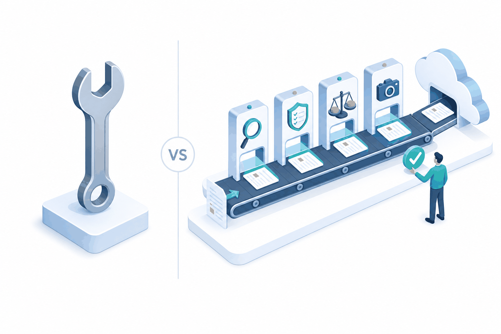

# bicep-deploy vs bicep-action: A Tool or a Workflow?

# Azure/bicep-deploy vs bicep-action: A Tool or a Workflow?

I maintain [innofactororg/bicep-action](https://github.com/innofactororg/bicep-action), so I should say up front that I am not a neutral party. I am also the person who most needs this comparison to be honest, because every time someone evaluates bicep-action for a new estate, the first question is the obvious one: why not just use Microsoft's?

Microsoft's answer to "how do I deploy Bicep from a pipeline" is [Azure/bicep-deploy](https://github.com/Azure/bicep-deploy), published as the `azure/bicep-deploy@v2` GitHub Action, with the same engine shipped to Azure DevOps as the `BicepDeploy@0` task. It is official, MIT-licensed, actively developed, and its latest release, v2.5.0 at the end of October 2026, added what-if support for deployment stacks. If you need to deploy a Bicep file to Azure from CI, it does that, cleanly and with Microsoft behind it.

bicep-action answers a different question. It is not a deploy step; it is a deployment workflow. It plans every change in the pull request, posts the plan as a comment for people to review, runs quality gates, and deploys only the plan that was approved, on GitHub and Azure DevOps alike.

That distinction, a tool versus a workflow, explains almost every row in the grids below. Most of the time the right choice is obvious once you know which one you need. This post sets out what each does, where each is stronger, and where each falls short, using the current releases of both: `azure/bicep-deploy` v2.5.0 and `BicepDeploy@0`, and bicep-action `v2026.11.13`.

## Two different shapes

**Azure/bicep-deploy is a primitive.** One step, one operation. You give it a `type` (`deployment` or `deploymentStack`), an `operation` (`create`, `validate`, `whatIf`, and for stacks `delete`), a `scope`, and your template and parameters. It compiles the Bicep, calls Azure Resource Manager through the Azure SDK for JavaScript, and writes the result to the log. Everything else about your pipeline, when it runs, who approves it, what happens to the what-if output, is yours to build around it.

Under the hood it is a TypeScript Node 24 action. The engine lives in a shared package, `@azure/bicep-deploy-common`, which the Azure Pipelines `BicepDeploy@0` task also consumes, so both platforms get the same behaviour and the same input set. Authentication is separate: on GitHub you run `azure/login` first, and the action picks up the credential through a chained Azure credential; on Azure DevOps you pass a service connection.

**bicep-action is a workflow.** A plan action and a deploy action on GitHub, and a pipeline plus reusable stage templates on Azure DevOps, all running the same Bash scripts over the Azure CLI. The plan job builds, validates, runs the what-if, the delete gate, PSRule, a cost estimate and a snapshot check, then posts one comment on the pull request. The deploy job waits for an environment approval, deploys with the Bicep version and stack settings the plan used, and comments the result. Sign-in, provider registration and auto merge are part of it.

## At a glance

| | Azure/bicep-deploy | bicep-action |
|---|---|---|
| What it is | A deploy/validate/what-if step | A plan, review and deploy workflow |
| Maintainer | Microsoft | Innofactor (open source) |
| Licence | MIT | BSD 3-Clause |
| GitHub | `azure/bicep-deploy@v2` action | `plan` and `deploy` composite actions |
| Azure DevOps | `BicepDeploy@0` task (same engine) | Full pipeline and stage templates (same scripts) |
| Implementation | TypeScript, Node 24, Azure SDK for JS | Bash scripts over Azure CLI, Bicep CLI, jq |
| Runner OS | Any runner that runs Node actions | Linux (Bash) runners |
| Authentication | `azure/login` (GitHub), service connection (Azure DevOps) | Built in: OpenID Connect or secret (GitHub), service connection (Azure DevOps) |
| Where the what-if goes | Job log, colour-formatted | Pull request comment, logs artifact, and `whatif-summary.json` |
| Release model | Semantic versions, `v2` major tag | Dated releases, `v1` tag |

## Feature coverage

This is the grid most people want. "Build it yourself" means the capability is not in the tool but you can assemble it from the platform and your own scripts.

| Capability | Azure/bicep-deploy | bicep-action |
|---|---|---|
| Standard deployments: resource group, subscription, management group, tenant | Yes | Yes |
| Deployment stacks: resource group, subscription, management group | Yes | Yes |
| What-if for standard deployments | Yes | Yes |
| What-if for stacks | Yes (since v2.5.0) | Yes |
| Validate | Yes, with `validation-level` (`provider`, `template`, `providerNoRbac`) | Yes (validate step) |
| `.bicepparam` and JSON parameter files | Yes | Yes |
| Inline parameters | Yes (`parameters` input) | No |
| Exclude change types from what-if | Yes (`what-if-exclude-change-types`) | No input; ignore and no-change results are left out of the comment |
| Pin the Bicep version | Yes (`bicep-version` input) | Automatic: the deploy uses the version the plan recorded |
| Template outputs as step outputs | Yes, with `masked-outputs` | No; the deploy action has no outputs |
| Sovereign clouds | Yes (`environment` input) | No input |
| Delete a stack | Yes (`operation: delete`) | No |
| What-if posted to the pull request | Build it yourself | Yes, one comment per plan |
| Deploy result posted to the pull request | Build it yourself | Yes |
| Approval before deploy | Build it yourself with environments | Built in, through environments |
| Deploy exactly what was planned | Build it yourself (pass the same version and settings) | Yes: Bicep version, mode and stack settings enforced |
| Approval list for stack deletes | No | Yes, delete gate with approved resource IDs |
| Fail on non-deterministic deletes | No | Yes, in delete modes |
| Policy and best-practice checks | Build it yourself | PSRule for Azure, optional |
| Cost estimate and budget gate | Build it yourself | Azure Cost Estimator, optional failing threshold |
| Snapshot drift check | Build it yourself | Automatic when a snapshot file is committed |
| Machine-readable what-if summary | No | `whatif-summary.json` (counts, IDs, deterministic, blocked) |
| Wait for a new subscription to become visible | No | Yes, retries that one error up to 30 minutes |
| Register resource providers before deploy | No | Yes, from the providers the plan found |
| Keep existing tag values (such as `createdOn`) | No | Yes, scoped to resource groups you name |
| Auto merge after deploy | Build it yourself | Yes (GitHub) |
| One run at a time per target | Build it yourself | Documented concurrency pattern in every example |
| Multi-environment examples | Single-environment examples | Test → production examples for both platforms |

## Deployment stacks, side by side

Stacks are where both projects have invested most, and where they differ in philosophy rather than coverage.

| Stack option | Azure/bicep-deploy | bicep-action |
|---|---|---|
| Action on unmanaged resources | Separate settings for resources, resource groups and management groups (`delete` or `detach`) | One setting: `detachAll` (default), `deleteResources`, `deleteAll` |
| Deny settings mode | `none`, `denyDelete`, `denyWriteAndDelete` | `none`, `denyDelete`, `denyWriteAndDelete` |
| Deny settings excluded actions and principals | Yes | No |
| Deny settings on child scopes | Yes | No |
| Bypass the stack out-of-sync error | Yes | No |
| Stack description and tags | Yes | No |
| Deletes require an approval list | No | Yes |
| Re-check deletes immediately before deploy | No | Yes, in delete modes |
| Stack settings must match the plan | No | Yes |

Microsoft exposes more of the stack API, and if you need deny-setting exclusions for a break-glass principal, or per-scope control of what gets deleted, bicep-action cannot express that today.

bicep-action, on the other hand, treats deletion as something that needs a reviewed commit. With `action-on-unmanage-resources: delete` in Microsoft's action, removing a resource from the template deletes it on the next `create`. That is the documented, intended behaviour of a stack. Whether a human saw the what-if first depends entirely on how you built the pipeline around it. In bicep-action, a delete mode fails the plan unless every resource the stack would delete is listed by ID in an approved-deletes file, and fails it outright if Azure cannot determine every resource that might be deleted. The deploy job then runs that check again against the current state, because the plan may be hours old.

## Strengths and weaknesses, honestly

### Azure/bicep-deploy

**Where it is stronger**

- **It is Microsoft's.** Official support, the Bicep team's own contributors, a Contributor Licence Agreement process, CodeQL and dependency automation. For organisations that only adopt vendor-supported tooling, that ends the discussion.
- **It is light and portable.** A single Node step with no Azure CLI dependency, running on Linux, Windows or macOS runners, with the Bicep binary kept in the runner's tool cache, so a self-hosted runner downloads each version once.
- **It exposes more of the API.** Validation levels, what-if change-type filters, inline parameters, sovereign clouds, stack delete, and the full set of stack and deny-setting options.
- **Outputs flow on.** Template outputs become step outputs, with masking for sensitive ones, so a later step can use the endpoint or resource ID the deployment produced.
- **Same engine on both platforms.** The GitHub Action and the `BicepDeploy@0` task share one package, so behaviour matches.
- **It composes.** Because it does one thing, it fits into whatever pipeline design you already have.

**Where it falls short**

- **It is not a review workflow.** The what-if goes to the job log. Getting it in front of a reviewer, gating the deploy on that review, and posting the result back are all left to you.
- **Plan and deploy are separate, unrelated runs.** The examples validate on pull requests and create on push to main. Nothing records what the what-if run used, so nothing guarantees the deployment matches what anyone looked at, unless you pin the Bicep version and settings yourself in both places.
- **Deletes are not gated.** Stacks will delete what you tell them to, with no approval list and no check for hidden deletes.
- **No quality gates.** Policy checks, cost estimates and drift checks are outside its scope.
- **Young in places.** Stack what-if arrived in v2.5.0 in October 2026, and the Azure DevOps task is still on major version 0.

### bicep-action

**Where it is stronger**

- **The workflow is the product.** Plan in the pull request, one comment with everything a reviewer needs, approval through the platform's own environments, deployment of the approved plan, result posted back. Nothing to assemble.
- **Deploy matches plan as closely as ARM allows.** The deploy installs the plan's Bicep version, refuses different stack settings, and re-runs the delete gate. ARM has no saved plan file, so this is not a guarantee in the way Terraform's is, but it closes the gaps a pipeline can close.
- **Safety by default.** Deletes need a reviewed list of IDs, non-deterministic deletes fail, PSRule and a cost budget can fail the plan, and a committed snapshot catches template drift, including drift caused by a Bicep release.
- **Built for the details that break real pipelines.** New subscriptions that are not visible yet, providers that are not registered, `createdOn` tags that should not be overwritten, masked values that garble a comment. Each feature exists because a production pipeline hit it.
- **Automation-ready.** `whatif-summary.json` lets you auto-approve plans that are provably safe and route the rest to a person.
- **Same comments on GitHub and Azure DevOps,** including multi-environment stage templates for Azure DevOps.

**Where it falls short**

- **It is not Microsoft's.** It is maintained by a partner team, and its priorities follow the production estates it runs in.
- **Linux and Bash only.** It shells out to the Azure CLI, Bicep CLI, jq and Perl, so it needs a Linux runner and is slower to start than a single Node step.
- **Narrower API surface.** No sovereign-cloud input, no inline parameters, no validation-level or what-if filters, no stack delete operation, and fewer stack and deny-setting options.
- **No deployment outputs.** If a later step needs a value the template produced, you query Azure for it.
- **Opinionated.** It assumes pull requests, environments and approvals. If your process deploys on push without review, most of what it does is in the way.
- **Azure DevOps downloads the scripts at run time** from GitHub at the pinned release, so agents need to reach GitHub, and the template repository is referenced through a GitHub service connection.

## Which one should you use?

Use **Azure/bicep-deploy** when you need a deployment step inside a pipeline you already own: a release pipeline with its own gates, a tool that consumes deployment outputs, a sovereign cloud, Windows runners, stack options bicep-action does not expose, or a policy that only vendor-supported tooling is allowed. It is also the right building block if you want to design your own review workflow from scratch.

Use **bicep-action** when what you want is the workflow: changes reviewed as plans in pull requests, deletes approved in commits, cost and policy checked before anyone deploys, and the same experience on GitHub and Azure DevOps. It is the one to pick when the question is not "how do I deploy this file" but "how do I stop anyone deploying something nobody looked at".

They are not really competitors. bicep-deploy is a good primitive, and bicep-action is a workflow that today happens to be built on the Azure CLI rather than on that primitive. The gaps in the grids above run in opposite directions, which is usually a sign that two tools are solving different problems well. If you are standing at that fork, start from the question you are actually trying to answer, and the grid will tell you the rest.

## Sources

- [Azure/bicep-deploy](https://github.com/Azure/bicep-deploy): README, `action.yml`, examples and release notes for v2.4.0 and v2.5.0
- [`BicepDeployV0` task](https://github.com/microsoft/azure-pipelines-tasks/tree/master/Tasks/BicepDeployV0) in microsoft/azure-pipelines-tasks
- [innofactororg/bicep-action](https://github.com/innofactororg/bicep-action): README, how it works, configuration reference and examples at `v2026.11.13`

