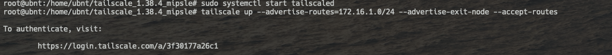
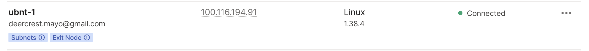
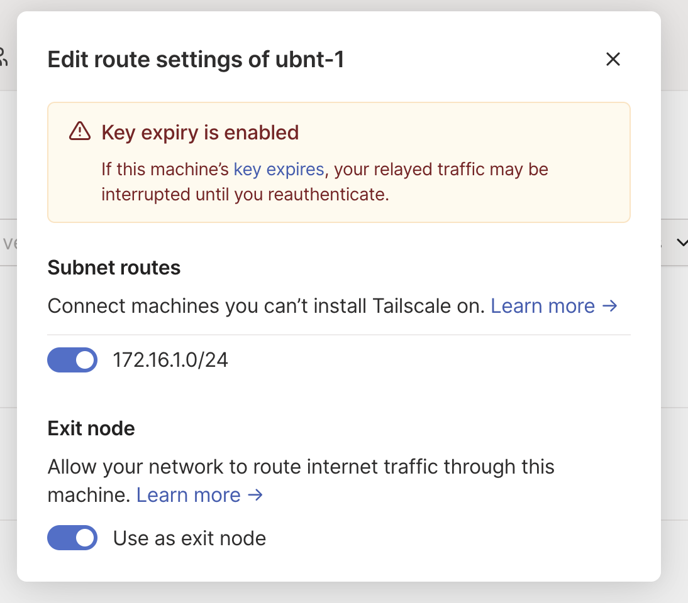

# Running Tailscale on a Ubiquiti EdgeRouter X


# Running Tailscale on a Ubiquiti EdgeRouter

Having grown up in the world of 'on premise' computing, I have always prioritized data privacy in my home network. 

Though there may not be much of interest to hackers, there is still personal data and services that I want to keep secure. I have spent years working with OpenVPN and IPSec, building and supporting a Dynamic Multi-site VPN Mesh with Cisco DMVPN, and I know first hand the challenges of connecting clients to a private network and managing keys. 

When WireGuard emerged a few years ago, I quickly switched to an Edge Router X to make it my default VPN technology. Though WireGuard had some scaling challenges to manage, it was still significantly easier to use than what I was used to. 

Then Tailscale came along, which made WireGuard even more user-friendly with additional security features like key rotation and single sign-on. While I’ve been using Tailscale on all of my systems, including Linux, macOS, and iOS, I recently decided to shift the endpoint to the edge of my network to make connectivity even easier.

> [!Note] December 2024 Update
> My EdgeRouter passed away, it served me well, and has been replaced by a UniFi Cloud Gateway Max, And is quite happy to assume the `tailscale` responsibility


> [!Note] June 2024 Update
> Latest builds now support the `tailscale update` command, which makes the maintenance trivial.
> Removed defunct configuration details from the post

> [!Note] April 2023 Update
> Updating notes to reflect switch from Unstable which I have been using since verision 1.7, to the current stable branch running 1.38.

> [!Note] November 2023 Update
> Updating notes to reflect switch from stable 1.40 to 1.50.

## Ubuquiti Edge Router X

The router at the edge of my home network is currently a Ubiquiti EdgeRouter X, which boasts a power-efficient MIPSLE CPU and runs on a Linux-based operating system that was derived from VyattaOS. 

The device offers a wide range of settings that can be adjusted via SSH that are not available through the web UI. With Tailscale, which provides MIPS binaries in addition to ARM, I can now connect the router to Tailscale and treat it like any other Linux system. 

In this post, we'll explore how to configure the EdgeRouter to function as a gateway, allowing external systems to access internal networks.


## Installation and Upgrade

The Tailscale client comes in two branches, Tailscale Unstable and Tailscale Stable. While Unstable was necessary for me a few years ago, I now prefer using Stable. To download the latest version for the MIPS platform, visit the [Tailscale Stable](https://pkgs.tailscale.com/stable/?ref=www.damianflynn.com#static) page and scroll down to find the current build, such as *tailscale_1.54.0_mips.tgz*.

To install and set up Tailscale, follow these steps:

1.  Navigate to your home folder and download the current build. Then, extract it and delete the download file:
   
```shell
cd ~
curl https://pkgs.tailscale.com/stable/tailscale_1.54.0_mipsle.tgz -o tailscale.tgz  
tar xzvf tailscale.tgz  
rm tailscale.tgz
```
   
2. Move the extracted files to their proper locations on the router and create the necessary directories for log data and runtime socket file:

```shell
# Change into a real shell and switch to root user 
sudo bash 
    
# Navigate to the extracted download 
cd tailscale_1.50.0_mipsle 
    
# Move the application to the right location 
mv tailscale* /usr/sbin 
    
# Place systemd and defaults into etc 
mv systemd/tailscaled.service /etc/systemd/system 
mv systemd/tailscaled.defaults /etc/default/tailscaled 
    
# Create the state storage folders 
mkdir /var/lib/tailscale /run/tailscale

# Create a symbolic link from /usr/bin which is in the path
sudo ln -s /usr/sbin/tailscale /usr/bin/tailscale
```

### Initial Confuration

The following steps are not typically required if you are upgrading between versions; however if this is a fresh installation you will need to start the service, and authenticate your node with the tailnet.

1. Start it up! If you have any issues, they should appear here as the service gets started. Check the logs by tailing the output from Tailscale using  `tail -f /var/log/messages`.

```shell
systemctl enable --now tailscaled
```

 2. Authenticate your device to Tailscale by starting it up and following the instructions. You can also use some options, such as:
    - `--advertise-routes`: a comma-separated list of subnets that other clients can reach via this router
    - `--advertise-exit-node`: allows any Tailscale instance to act as an exit node, sending your otherwise-public traffic to a specific node that will NAT your traffic out to the internet. This option is useful when you're on an untrusted network or if you want to source your traffic from a different network.

```shell
tailscale up --advertise-routes=172.16.1.0/24 --advertise-exit-node --accept-routes
```
```

When you start Tailscale, it will present you with a URL to visit that allows you to authenticate the device to your Tailscale account. 
- 
- Once you do this, your router will show up under the “Machines” list in the admin UI
- 

> [!Warning] Disconnect
> At this point all traffic on the router will appear to black hole for both ingress and egress. 
> To restore service, we must acknowledge the settings in the Tailscale portal; this may required that you use an alternate device that is not on this network to reach the port. Once in the portal we should validate and enable both settings we applied in the `tailscale up` command, which will then unblock the device
> 


## Final Testing

If you’ve made it this far, you should be able to ping other Tailscale nodes bidirectionally.

If you’d like hosts behind the EdgeRouter to communicate to other Tailscale clients outside the local network, you’ll want to add a NAT so that traffic knows where to go (without one, you’ll only have inbound access to devices on the network). To do this, you can add it via CLI:

```shell
router$ configure
router# set service nat rule 5012 description Tailscale
router# set service nat rule 5012 outbound-interface tailscale0
router# set service nat rule 5012 protocol all
router# set service nat rule 5012 type masquerade
```

…or find it in the Ubiquiti web UI under “Firewall/NAT” and click a few options. The `tailscale0` interface will not show up in the dropdown list, so you must choose “Other” and type in `tailscale0`.

---
<!-- enrich:containment -->
*Part of: damianflynn*

